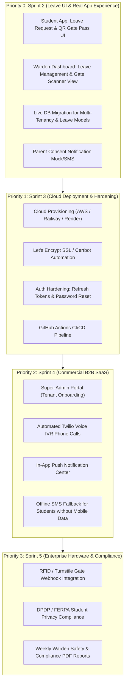

# HostelGuard — Project Master Task List & Commercial Roadmap

> [!IMPORTANT]
> **ATTENTION TO ANY AI CODING AGENT OR DEVELOPER PICKING UP THIS REPOSITORY:**
> **READ THIS FILE FIRST BEFORE MAKING ANY CHANGES OR PROPOSING PLANS.**
> This is the single source of truth for the HostelGuard project. It documents:
> 1. Everything that is **already built, verified, and locked** (do not re-implement or break).
> 2. The strictly **prioritized backlog of what is to be built next** to transform HostelGuard from a local prototype into a production-grade, commercially viable B2B SaaS application.
> 3. The **non-negotiable architectural invariants** that must never be violated.

---

## Quick Navigation
- [System Overview & Architecture](#system-overview)
- [Part 1: What Is Built (Completed & Verified)](#part-1-what-is-built)
- [Part 2: What Is to Be Built Further (Prioritized Roadmap)](#part-2-what-is-to-be-built-further)
  - [Priority 0 (Sprint 2): Leave UI & Multi-Tenancy Live Wiring](#priority-0-p0---immediate-next-sprint)
  - [Priority 1 (Sprint 3): Cloud Deployment & Production Network Hardening](#priority-1-p1---production-network--deployment)
  - [Priority 2 (Sprint 4): Multi-Tenant SaaS Admin & Voice Escalation](#priority-2-p2---commercial-saas-admin--ivr)
  - [Priority 3 (Sprint 5): Enterprise Integrations & Compliance](#priority-3-p3---enterprise-hardware--compliance)
- [Non-Negotiable Invariants for Agents](#non-negotiable-invariants)
- [Verification & Testing Runbook](#verification-runbook)

---

## System Overview

HostelGuard is a mission-critical emergency response and student hostel management platform designed for universities, residential colleges, and boarding schools.

- **Student Mobile App:** Flutter (Android/iOS/Web) — one-tap SOS, live location tracking, leave application & digital gate pass.
- **Warden Dashboard:** React 19 + Vite + TypeScript + Tailwind CSS + Leaflet Maps + Socket.IO client.
- **Backend Services:** Node 20+ / Express 5 / TypeScript / Socket.IO 4 with Redis adapter / Prisma 6 ORM.
- **Data & Queue Layer:** PostgreSQL 16 (transaction pooled) + Redis 7 (BullMQ delayed queues + Pub/Sub + rate limit store).
- **Notification & Escalation:** Twilio (SMS & Voice IVR) + Firebase Cloud Messaging (FCM web push).
- **Observability:** Prometheus metrics (`/metrics`) + Grafana dashboards + Alertmanager.

---

## Part 1: What Is Built

### 1. Core SOS & Emergency Pipeline (Completed & Proven)
- [x] **One-Tap SOS Loop:** Student app triggers emergency; coordinates persisted to PostgreSQL in under 100ms.
- [x] **Real-Time Cross-Instance Socket.IO Broadcast:** Redis adapter fans out `alert:new` to all warden dashboard instances across the cluster.
- [x] **Automated 60s Escalation:** BullMQ delayed job schedules Twilio SMS escalation if no warden acknowledges within 60s. Survives API/worker restarts.
- [x] **Full Alert Lifecycle:** Transitions strictly enforced: `PENDING` -> `ACKNOWLEDGED` -> `RESOLVED` (requires 10-500 character resolution note).
- [x] **Audit Trail & CSV Export:** Paginated historical search with date/status filters and streaming CSV export.
- [x] **Leaflet Live Map:** Student GPS location with accuracy circle displayed in the warden dashboard.

### 2. High-Availability & Safety Hardening
- [x] **Fail-Open SOS Path:** If Redis is down, SOS creation still succeeds (HTTP 201 in <100ms) and commits to DB.
- [x] **Break-Glass SOS Rate Limiting:** Rate limiter allows emergency overrides when student presses SOS multiple times (`sos_overrides_total` metric increments, never returns 429).
- [x] **Honest Escalation Pill:** Server relays real Twilio delivery confirmation (`alert:escalated` / `alert:escalation-failed`) rather than relying on a client-side timer.
- [x] **Secret Scanner:** Husky pre-commit hook preventing accidental leaks of Twilio keys, JWT secrets, and certificates.

### 3. Code Quality & Ponytail Audit Fixes
- [x] **Warden-Only Socket Metrics:** Connected metric only counts wardens so student connections do not mask offline wardens.
- [x] **CSV Stream UTF-8 Encoding:** Replaced `objectMode: true` with proper byte encoding.
- [x] **Alert Type Selector:** Student app provides ChoiceChip selection for `Medical`, `Fire`, `Security`, and `Other` emergencies.
- [x] **SMS Relay Retry:** Escalation processor retries internal notification relay on transient network hiccups.
- [x] **Socket Handshake Limiter Memory Cleanup:** Periodic garbage collection sweep prevents IP tracking memory leaks.

### 4. Sprint 1: Production Infrastructure & Multi-Tenancy Architecture
- [x] **Multi-Stage Production Dockerfile:** `backend/Dockerfile` with `node:20-alpine`, non-root user (`hostelguard`), `/health` check.
- [x] **Full Production Compose Stack:** `docker-compose.prod.yml` orchestrating PostgreSQL 16, Redis 7 (AOF + `noeviction`), API cluster (2 replicas), Escalation Worker, Leave Worker, and Nginx.
- [x] **Production Nginx Proxy:** `nginx/nginx.conf` with TLS termination, WebSocket upgrades, rate limiting zones, and HTTP-to-HTTPS redirect.
- [x] **Environment Configs:** Production `.env.production.example` for backend and dashboard.
- [x] **Flutter Network Configuration:** `student_app/DEPLOYMENT.md` for building release APKs/bundles pointing to any domain via `--dart-define=API_URL=...`.
- [x] **Multi-Tenancy Prisma Models:** Added `Organization` (tenant), `Campus`, and `Block` models with foreign keys in `Student`, `Warden`, and `EmergencyAlert`.

### 5. Sprint 1: Leave Management & Gate Pass Scaffold
- [x] **Prisma Leave Model:** 22-field `LeaveRequest` model with 3 indexes and full lifecycle states (`SUBMITTED`, `APPROVED`, `REJECTED`, `DEPARTED`, `RETURNED`, `OVERDUE`, `CANCELLED`).
- [x] **13 REST API Endpoints:** `backend/src/routes/leave.routes.ts` mounted at `/leaves` with RBAC, gate pass generation, and stats.
- [x] **Leave Overdue Background Worker:** `backend/src/workers/leave-overdue.worker.ts` running BullMQ repeatable job every 5 minutes to mark expired leaves `OVERDUE`.
- [x] **Observability:** Added `leave_requests_total`, `leave_overdue_total`, and `leave_currently_away` Prometheus metrics.

---

## Part 2: What Is to Be Built Further



---

### Priority 0 (P0) — Immediate Next Sprint: Leave UI & Multi-Tenancy Wiring
*Goal: Give students and wardens the complete visual interface for leaves and gate passes so it functions 100% end-to-end.*

- [ ] **Task P0.1: Database Migration Deployment**
  - Run `npx prisma migrate dev --name add_multitenancy_and_leaves` against a running PostgreSQL instance.
  - Update `prisma/seed.ts` to seed an initial `Organization` ("Acme University"), `Campus` ("Main Campus"), `Block` ("Block A (Boys)", "Block B (Girls)"), and assign demo students/wardens to blocks.
- [ ] **Task P0.2: Flutter Student Leave UI**
  - Screen `lib/screens/leave_apply_screen.dart`: Form for departure time, expected return, reason, destination, emergency contact, type dropdown (`DAY_OUTING`, `NIGHT_OUT`, `HOME_VISIT`, `MEDICAL`).
  - Screen `lib/screens/leave_status_screen.dart`: Active leaves list with visual badges (`PENDING`, `APPROVED`, `DEPARTED`, `OVERDUE`).
  - Screen `lib/screens/gate_pass_qr_screen.dart`: Displays the generated `HG-XXXX` code and high-contrast QR code for security guard scanning.
  - Off-campus SOS button on the gate pass screen that calls `POST /leaves/:id/emergency`.
- [ ] **Task P0.3: Warden Dashboard Leave Management View**
  - New tab: **Leave Requests & Outings**.
  - Sub-views:
    - *Pending Approvals:* Table with student room, destination, reason, departure/return dates, and one-click "Approve" / "Reject" actions.
    - *Currently Away:* Live counter and search list of students currently outside the gate.
    - *Overdue Alerts:* Red-flagged list of students who have not returned past `expectedReturn`.
    - *Gate Verification Modal:* Quick input/scanner for security to enter `HG-XXXX` code or scan QR to mark departure/return.
- [ ] **Task P0.4: Parent Notification Trigger**
  - Hook into `POST /leaves` or `PATCH /leaves/:id/review` to trigger an SMS/WhatsApp dispatch to the student's emergency contact when `NIGHT_OUT` or `HOME_VISIT` is requested.

---

### Priority 1 (P1) — Production Network & Deployment
*Goal: Deploy the application on public cloud infrastructure accessible securely from any cellular or Wi-Fi network.*

- [ ] **Task P1.1: Cloud Hosting Setup (Managed PostgreSQL & Redis)**
  - Deploy backend containers on AWS ECS, Railway, Render, or DigitalOcean droplet.
  - Provision managed PostgreSQL (e.g., Neon / Supabase / AWS RDS) with PgBouncer connection pooling.
  - Provision managed Redis 7 (e.g., Upstash / AWS ElastiCache) with persistence enabled (`noeviction`).
- [ ] **Task P1.2: Domain & Automated SSL (Let's Encrypt / Cloudflare)**
  - Configure public DNS: `api.hostelguard.com` (API) and `dashboard.hostelguard.com` (React dashboard).
  - Setup Certbot in Docker Compose or terminate TLS at Cloudflare / AWS ALB.
- [ ] **Task P1.3: Authentication & Security Hardening**
  - Implement short-lived Access Tokens (15m) + secure HTTP-only Refresh Tokens (30d) with revocation in Redis.
  - Add "Forgot Password" / Password Reset token email flow.
- [ ] **Task P1.4: CI/CD Pipeline (GitHub Actions)**
  - `.github/workflows/deploy.yml`: Lint -> Vitest test suite -> Docker build & push -> SSH/Webhook redeploy.

---

### Priority 2 (P2) — Commercial SaaS Admin & IVR
*Goal: Tools to sell and onboard multiple universities, plus critical backup phone calling.*

- [ ] **Task P2.1: Multi-Tenant Super-Admin Dashboard**
  - Separate secure portal for SaaS operators to onboard new educational institutions.
  - CRUD for Organizations, Campus blocks, student license caps, and billing plans.
  - Tenant database isolation validation.
- [ ] **Task P2.2: Automated Voice Calling Escalation (Twilio Voice IVR)**
  - If an emergency SOS is still `PENDING` at T+120 seconds after SMS, initiate an automated phone call to the head warden / campus security desk with text-to-speech announcement.
- [ ] **Task P2.3: Offline SMS Fallback (Zero-Data SOS)**
  - For students in areas with zero mobile data/Wi-Fi: Configure an incoming Twilio SMS webhook `POST /alerts/sms-webhook` allowing students to text `"SOS <ROOM_NUMBER>"` to trigger an alert.

---

### Priority 3 (P3) — Enterprise Hardware & Compliance
*Goal: Deep hardware integration and institutional compliance for university tenders.*

- [ ] **Task P3.1: Turnstile & RFID Gate Hardware Webhook**
  - Webhook API endpoint `POST /api/v1/gate-hardware/event` allowing physical biometric turnstiles or RFID scanners to auto-trigger `gate-departure` and `gate-return`.
- [ ] **Task P3.2: Data Privacy & DPDP/FERPA Compliance**
  - Data retention policies: auto-archive resolved alerts after 90 days.
  - Anonymization features for medical condition fields to comply with health privacy standards.
- [ ] **Task P3.3: Automated Executive Safety PDF Reports**
  - Weekly cron generating PDF summary of response times, peak SOS hours, and leave compliance statistics for the Dean of Student Affairs.

---

## Non-Negotiable Invariants

Any agent working on HostelGuard must preserve these rules:

1. **Adapter Before Listen:** `io.adapter(createAdapter(pub, sub))` MUST be invoked before `httpServer.listen()`.
2. **Worker Fork Mode:** The BullMQ escalation worker must run as a single process (`instances: 1`, `exec_mode: "fork"`). Never cluster the worker.
3. **Redis Client Isolation:** BullMQ queue, Socket.IO adapter PUB, adapter SUB, and rate limiters must each use independent ioredis connections.
4. **PostgreSQL as Source of Truth:** Sockets, FCM, and SMS are delivery channels; a delivery failure must never cancel or roll back an alert DB commit.
5. **Idempotency Guard:** The worker must verify `if (alert.status !== 'PENDING') return;` before dispatching SMS.
6. **Break-Glass SOS Limiting:** The SOS rate limiter must NEVER block a real emergency with a 429; it must fail open and log an override.
7. **Stateless JWTs:** Do not add a server-side session store. Keep authentication tokens stateless.
8. **Case Normalization:** Roles (`STUDENT`, `WARDEN`) and alert types (`MEDICAL`, `FIRE`, `SECURITY`, `OTHER`) are uppercase in DB and APIs.

---

## Verification Runbook

Before completing any task or committing changes, run this checklist:

```bash
# 1. Validate Prisma Schema
cd backend
npm run db:validate

# 2. Build Backend (TypeScript)
npm run build

# 3. Build Warden Dashboard (TypeScript + Vite)
cd ../warden-dashboard
npx tsc --noEmit
npx vite build

# 4. Verify Secret Scanner
cd ..
git status
# Ensure no real .env or keys are staged
```
